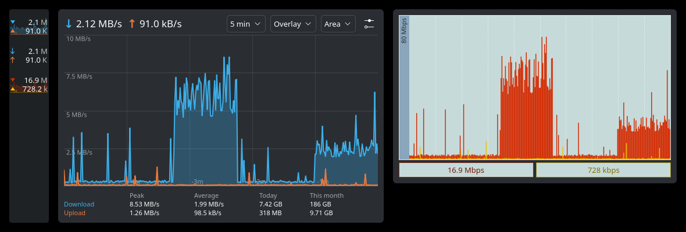

# Net Meter

A network speed meter for the KDE Plasma 6 panel. It shows live download and
upload speeds and opens a history graph when clicked. The look is inspired by
the classic DU Meter.



## Features

- Compact download/upload readout sized to fit narrow vertical panels, with an
  optional mini graph behind or below the numbers
- History graph of 1–60 minutes: overlay, split or mirrored layout; line,
  area or bar style; automatic, fixed or logarithmic scale. Samples are kept
  for the longest window, so widening it shows data already collected
- Hover the graph for the exact speeds at any moment
- Peak and average speeds, plus daily and monthly traffic totals that persist
  across restarts
- Two built-in looks (Plasma and Classic Meter) that remember your tweaks,
  switchable from the right-click menu
- Bytes or bits, decimal or binary prefixes, any interface or all of them

## Install

Requires Plasma 6.

```sh
git clone https://github.com/Tiaxi/plasma-netmeter.git
kpackagetool6 -t Plasma/Applet -i plasma-netmeter/package
```

Then right-click the panel → **Add Widgets…** → **Net Meter**.

To update after pulling changes:

```sh
kpackagetool6 -t Plasma/Applet -u plasma-netmeter/package
systemctl --user restart plasma-plasmashell
```

## Notes

- Speeds and totals come from Plasma's system monitor service (`ksystemstats`),
  which reads the kernel's interface byte counters.
- Totals count all traffic on the selected interface, local network included.

## License

GPL-2.0-or-later. See [LICENSE](LICENSE).
